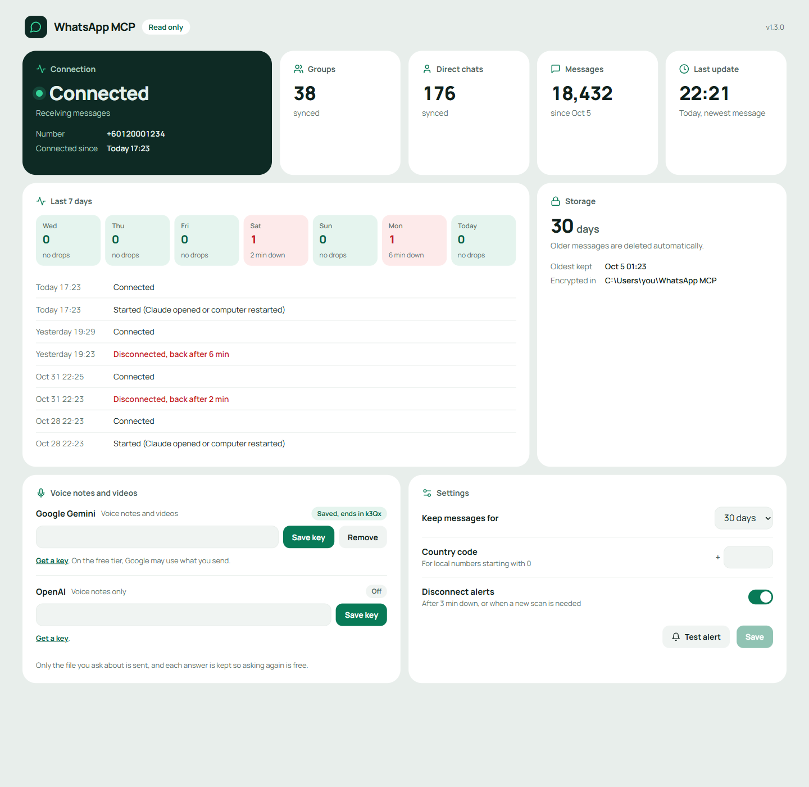

# WhatsApp MCP

Let Claude read your own WhatsApp: summaries, search, pictures, voice notes and videos. It never sends a message. Your messages stay on your computer, encrypted.

[中文说明](README.zh.md)

## Easiest setup: let your AI do it

If you use Claude Code, open it and say:

> Set up this app for me: https://github.com/stevenpkm/whatsapp-mcp-desktop

The agent follows [AGENTS.md](AGENTS.md) and does every step itself. You only restart Claude Code once and scan a QR code with your phone. Claude Code needs Node 22.5 or newer; the agent checks it.

## Setup in Claude Desktop, step by step

Works on Windows and Mac. No Node, no terminal, no ports to open.

**Step 1. Install Claude Desktop**
Download it from [claude.ai/download](https://claude.ai/download), install it and sign in.

**Step 2. Download the install file**
Go to [Releases](https://github.com/stevenpkm/whatsapp-mcp-desktop/releases/latest) and download `whatsapp-mcp-desktop.mcpb`.

**Step 3. Install it in Claude**
Double-click the file. Claude opens and shows the extension. Press **Install**.
Nothing happens? Open Claude > Settings > Extensions and drag the file into that window.

**Step 4. Connect WhatsApp**
Start a new chat in Claude and say: **connect my WhatsApp**
A page with a QR code opens in your browser.

**Step 5. Scan the QR**
On your phone: WhatsApp > Settings > Linked devices > Link a device (Android: the ⋮ menu > Linked devices). Scan the QR on the page.
The QR changes by itself every 20 seconds or so; you don't need to refresh. When the page says **Connected**, you are done.

**Step 6. Try it**
Back in Claude, ask: **summarize my WhatsApp today**

## What you can ask

| You say | Claude does |
|---|---|
| Is my WhatsApp connected? | Tells you the connection status |
| Summarize my WhatsApp today | Reads today's messages and sums them up |
| Find the invoice | Searches your messages |
| What's in the picture Ahmad sent? | Looks at the picture |
| What did Ahmad say in his voice note? | Turns the voice note into text (needs a key, see below) |
| What's in the video Mei sent? | Describes the video and what is said (needs a Gemini key) |
| What's the total on the invoice Ahmad sent? | Reads the text inside the PDF |
| Save that PDF | Saves it to Downloads > WhatsApp MCP |
| Save all the invoices from the Supplier group | Saves every matching file of that chat into one folder |
| Open the WhatsApp settings page | Opens the settings page |
| Reconnect my WhatsApp | Shows a new QR, to relink or change number |

## Files and documents

Pictures are kept as they arrive. Other files (PDFs, Word, Excel, voice notes, videos) are fetched from WhatsApp only when you ask, so they need WhatsApp connected at that moment.

- **Read a document**: Claude reads the text inside PDFs and text files (txt, md, csv, json, html). Scanned PDFs, Word and Excel files cannot be read this way; save them instead.
- **Save one file or a whole chat**: files go to Downloads > WhatsApp MCP (a whole chat into its own folder), under the sender's file name. Files there are not encrypted.
- **Put them somewhere else**: each saved file comes with its full path and SHA-256, so another connector can pick it up. Example: with a Google Drive connector in Claude, say "save all the invoices from the Supplier group and put them in my Drive folder Invoices".
- Files up to 25 MB (videos 100 MB). Very old files may be gone from WhatsApp; they are listed as skipped.

## The settings page

Say **open the WhatsApp settings page**. It shows:

- **Connection**: connected or not, your number, since when
- **Groups, Direct chats, Messages**: how much is synced, and since which day
- **Last update**: the time of the newest message
- **Last 7 days**: one tile per day with the drops and how long each lasted
- **Storage**: how many days messages are kept, and the oldest one kept

And lets you change:

- **Keep messages for**: 7, 14, 30 (default) or 90 days. Older messages are deleted automatically.
- **Country code**: for local numbers that start with 0 (60 for Malaysia, 65 for Singapore, 44 for the UK). Leave it empty if you always use full numbers.
- **Disconnect alerts**: a desktop alert when WhatsApp is down for 3 minutes, or needs a new scan. Press **Test alert** to see one.

## Voice notes and videos (optional)

Claude can see pictures by itself, but it can't hear voice notes or watch videos. Paste an API key on the settings page and it can.

| Key | Does | Get one |
|---|---|---|
| Google Gemini | Voice notes and videos | [aistudio.google.com/apikey](https://aistudio.google.com/apikey) |
| OpenAI | Voice notes only | [platform.openai.com/api-keys](https://platform.openai.com/api-keys) |

1. Open the settings page (say **open the WhatsApp settings page**).
2. Under **Voice notes and videos**, paste the key and press **Save key**. It checks the key with Google or OpenAI first and only saves a working key.
3. With both keys saved, choose which one does voice notes under **Voice notes with**.

Good to know:
- Only the one file you ask about is sent, and only to the service whose key you saved.
- Each answer is kept (encrypted), so asking about the same file again costs nothing.
- The key is stored encrypted on your computer. The page shows only its last 4 characters.
- On Google's free tier, Google may use what you send to improve its products. A paid key avoids that.
- Using a key costs money on that service's account (usually very little per voice note).

## Updating

- **Claude Desktop**: download the new `whatsapp-mcp-desktop.mcpb` from Releases and install it the same way. Your WhatsApp link and messages stay; no new scan.
- **Claude Code**: say "update WhatsApp MCP to the latest version: https://github.com/stevenpkm/whatsapp-mcp-desktop". Steps are in [AGENTS.md](AGENTS.md).

Each Release lists the SHA-256 of the install file, so you or your agent can check the file is the real one.

## When something goes wrong

| What you see | What to do |
|---|---|
| Double-click does nothing | Claude > Settings > Extensions, drag the file in |
| The QR page did not open | Ask Claude "connect my WhatsApp" again; it also gives the link to open by hand |
| A page says **Not reachable** or **Can't reach the program** | Open Claude, then refresh the page |
| Settings page says **Needs a new scan** | The link was removed on the phone. Say "reconnect my WhatsApp" and scan again |
| Settings page says **Disconnected** for long | Check your internet, then press **Reconnect now** |
| No new messages after a long time offline | If the phone was offline for about 14 days, WhatsApp removes the link. Scan again |
| The settings page will not save a key | It says why (usually a wrong key). Copy the key again from the service's site |
| Claude says the key was refused or has no credit | Check the key or add credit on that service's site, or save another key |

Claude can read the log at `<your user folder>/WhatsApp MCP/helper.log` to explain a problem. The log never has message text.

## Good to know

- **Not official.** It connects the way WhatsApp Web does (a linked device). WhatsApp does not allow unofficial apps, so a number can be banned. Read only is lower risk, but not zero. Use a second number if you can.
- **Messages are written by other people.** Claude is told never to follow instructions found in a message. Still, don't ask Claude to act on what a message says without checking it yourself.
- **Only link your own number.**
- **When it receives messages.** Installed in Claude Desktop: while Claude is open. Installed with Claude Code: in the background until the computer shuts down. After a gap, only recent messages come back.
- **Where the data is.** `<your user folder>/WhatsApp MCP`, encrypted. The key to open it is on the same computer, so anyone who can use this computer can read it.
- Files saved to Downloads are not encrypted.
- Nothing goes to the internet except WhatsApp itself, and Gemini or OpenAI only if you saved a key and asked about a voice note or video.

## Remove it

1. Phone: WhatsApp > Linked devices > tap **WhatsApp MCP** > Log out
2. Claude > Settings > Extensions > remove **WhatsApp (read only)**. Claude Code: `claude mcp remove whatsapp`
3. Delete the folder `<your user folder>/WhatsApp MCP`

## For developers

- Node 22.5 or newer. `npm install`, then `npm run selftest`: builds the install file and runs every check with fake data and stand-ins for Gemini and OpenAI (no WhatsApp, no real keys).
- The install file is built to `dist/whatsapp-mcp-desktop.mcpb`. It holds two bundled JS files, no native parts, so one file works on Windows and Mac.
- `src/index.ts`: the program Claude starts. It only passes messages to `src/helper.ts`, which holds the WhatsApp connection, the database and the pages. The helper listens on 127.0.0.1 only, on a port the system picks; the pages need a random key in the link, and the MCP endpoint a token.
- WhatsApp engine: [Baileys](https://github.com/WhiskeySockets/Baileys), pinned at 6.7.24.
- Developer and test settings: [.env.example](.env.example). Normal use needs none of them.

MIT License. Third-party licenses are listed in `THIRD_PARTY_NOTICES.txt` inside the install file. Not affiliated with WhatsApp, Meta, Google, OpenAI or Anthropic.
