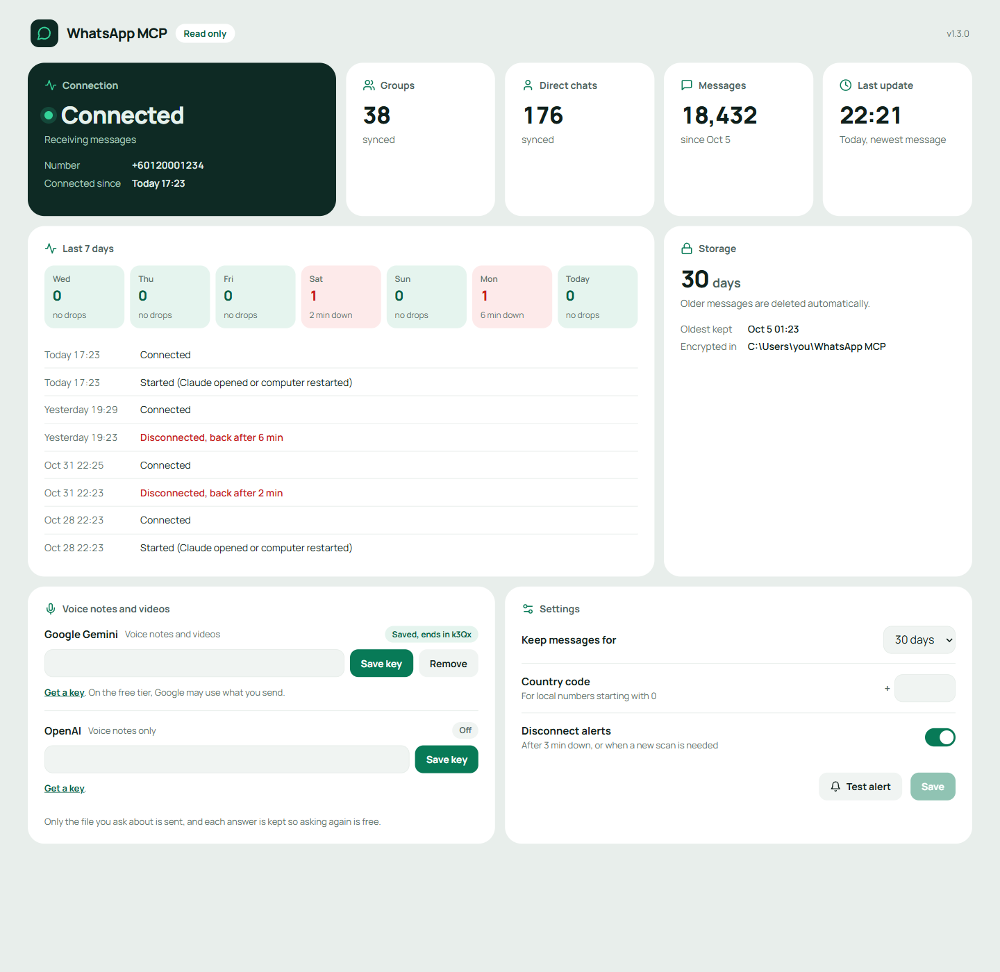

# WhatsApp MCP

让 Claude 读你自己的 WhatsApp：帮你总结、找讯息、看图片、听语音、看 video。它不会帮你发任何讯息。讯息只存在你自己的电脑，而且是加密的。

[English](README.md)

## 最简单：叫你的 AI 帮你装

有用 Claude Code 的话，打开它，讲：

> Set up this app for me: https://github.com/stevenpkm/whatsapp-mcp-desktop

它会照 [AGENTS.md](AGENTS.md) 一步一步自己做完。你只需要重开一次 Claude Code，再用手机扫一次 QR。Claude Code 这条路要 Node 22.5 以上，它会帮你检查。

## 用 Claude Desktop 装，一步一步来

Windows 和 Mac 都可以。不用装 Node，不用开 terminal，也不用开什么 port。

**第 1 步：装 Claude Desktop**
到 [claude.ai/download](https://claude.ai/download) 下载，装好之后登入。

**第 2 步：下载安装 file**
到 [Releases](https://github.com/stevenpkm/whatsapp-mcp-desktop/releases/latest) 下载 `whatsapp-mcp-desktop.mcpb`。

**第 3 步：装进 Claude**
Double-click 这个 file，Claude 会打开，按 **Install**。
没反应的话：打开 Claude > Settings > Extensions，把 file 拖进去。

**第 4 步：连接 WhatsApp**
在 Claude 开一个新 chat，讲：**connect my WhatsApp** (讲 "连接我的 WhatsApp" 也可以)
浏览器会自己开一页 QR。

**第 5 步：扫 QR**
手机打开 WhatsApp > Settings > Linked devices > Link a device (Android 是右上角 ⋮ > Linked devices)，扫那一页的 QR。
QR 大约 20 秒会自己换一次，不用 refresh。页面写 **Connected** 就好了。

**第 6 步：试一下**
回去 Claude 问：**总结我今天的 WhatsApp**

## 你可以这样问

| 你讲 | Claude 会 |
|---|---|
| 我的 WhatsApp 连着吗？ | 告诉你连接状况 |
| 总结我今天的 WhatsApp | 读今天的讯息，写重点给你 |
| 找 invoice | 搜你的讯息 |
| Ahmad 发的那张图是什么？ | 看那张图 |
| Ahmad 的语音讲什么？ | 把语音转成文字 (要 key，看下面) |
| Mei 发的 video 是什么？ | 讲 video 里面有什么、讲了什么 (要 Gemini key) |
| 把那个 PDF 存起来 | 存去 Downloads > WhatsApp MCP |
| 开 WhatsApp 设定页 | 打开设定页 |
| 重新连接我的 WhatsApp | 出新的 QR，重新连或换号码 |

## 设定页

跟 Claude 讲 **开 WhatsApp 设定页**。上面看得到：

- **Connection**：连着没有、你的号码、几时连上的
- **Groups、Direct chats、Messages**：同步了多少个 group、多少个 chat、多少则讯息，从哪一天开始
- **Last update**：最新一则讯息的时间
- **Last 7 days**：一天一格，有断线就是红色，写断了多久
- **Storage**：讯息存几天、现在最旧的是哪一天

也可以改：

- **Keep messages for**：存 7、14、30 (默认) 或 90 天。更旧的会自动删掉。
- **Country code**：讲 0 开头的号码时用 (马来西亚 60、新加坡 65、英国 44)。都用完整号码的话可以留空。
- **Disconnect alerts**：断线 3 分钟还没连回去，或者要重新扫码，电脑会跳通知。按 **Test alert** 可以先看看。

## 语音和 video (可以不用)

照片 Claude 自己看得到，但是语音它听不到、video 它看不到。在设定页贴一个 API key 就可以了。

| Key | 可以做 | 去哪里拿 |
|---|---|---|
| Google Gemini | 语音和 video | [aistudio.google.com/apikey](https://aistudio.google.com/apikey) |
| OpenAI | 只有语音 | [platform.openai.com/api-keys](https://platform.openai.com/api-keys) |

1. 打开设定页 (跟 Claude 讲 **开 WhatsApp 设定页**)。
2. 在 **Voice notes and videos** 那里贴 key，按 **Save key**。它会先问 Google 或 OpenAI 这个 key 能不能用，能用才存。
3. 两个 key 都有的话，在 **Voice notes with** 选用哪一个来转语音。

要知道的：
- 只有你问的那一个 file 会送出去，而且只送去你存了 key 的那一家。
- 每个答案都会加密存起来，同一个 file 再问不用再付钱。
- Key 加密存在你的电脑，页面只显示最后 4 个字。
- 用 Google 免费的 key 的话，Google 有可能拿你送的东西去改进他们的产品。用付费的 key 就不会。
- 用 key 会从那一家的户口扣钱，一个语音通常很便宜。

## 更新

- **Claude Desktop**：到 Releases 下载新的 `whatsapp-mcp-desktop.mcpb`，一样 double-click 装。WhatsApp 连接和讯息都还在，不用重新扫码。
- **Claude Code**：讲 "update WhatsApp MCP to the latest version: https://github.com/stevenpkm/whatsapp-mcp-desktop"。步骤在 [AGENTS.md](AGENTS.md)。

每个 Release 都写着安装 file 的 SHA-256，你或者你的 AI 可以对一对，确认 file 没有被换过。

## 出问题的时候

| 你看到 | 怎样做 |
|---|---|
| Double-click 没反应 | Claude > Settings > Extensions，把 file 拖进去 |
| QR 页没有开 | 再跟 Claude 讲一次 "connect my WhatsApp"，它也会给你 link 自己开 |
| 页面写 **Not reachable** 或 **Can't reach the program** | 打开 Claude，再 refresh 那一页 |
| 设定页写 **Needs a new scan** | 手机那边取消了连接。讲 "重新连接我的 WhatsApp"，再扫一次 |
| 设定页一直写 **Disconnected** | 先看网络，再按 **Reconnect now** |
| 很久没上线之后收不到新讯息 | 手机大约 14 天没上线，WhatsApp 会踢掉连接，要重新扫 |
| 设定页存不进 key | 页面会写原因 (通常是 key 不对)，去那一家的网站重新 copy |
| Claude 说 key 被拒绝或没有 credit | 去那一家的网站看 key、加 credit，或者换一个 key |

出问题时，Claude 可以读 `你的用户 folder/WhatsApp MCP/helper.log` 帮你看。这个 log 不会有讯息内容。

## 先知道

- **不是官方的。** 它用 WhatsApp Web 一样的方式连 (linked device)。WhatsApp 不准非官方的程序，号码有机会被封。只读的风险比较低，但不是零。能用副号就用副号。
- **讯息是别人写的。** Claude 被规定不能照讯息里面的指示做事。不过讯息叫你做什么之前，还是自己先看清楚。
- **只连你自己的号码。**
- **几时收讯息。** 用 Claude Desktop 装的：Claude 开着才收。用 Claude Code 装的：在背后一直收，电脑关机才停。中间断掉的话，只补得回最近的讯息。
- **资料在哪里。** `你的用户 folder/WhatsApp MCP`，加密的。开锁的钥匙也在同一部电脑，所以能用这部电脑的人也读得到。
- 存去 Downloads 的 file 没有加密。
- 除了 WhatsApp 本身，什么都不会送上网。只有你存了 key、又问了语音或 video，那个 file 才会送去 Gemini 或 OpenAI。

## 删除

1. 手机：WhatsApp > Linked devices > 点 **WhatsApp MCP** > Log out
2. Claude > Settings > Extensions > 删掉 **WhatsApp (read only)**。Claude Code：`claude mcp remove whatsapp`
3. 删掉 `你的用户 folder/WhatsApp MCP` 这个 folder

## 给开发的人

开发的说明在 [README.md](README.md) 最下面 (英文)。

MIT License。用到的别人的软件和 license 写在安装 file 里面的 `THIRD_PARTY_NOTICES.txt`。跟 WhatsApp、Meta、Google、OpenAI、Anthropic 都没有关系。
